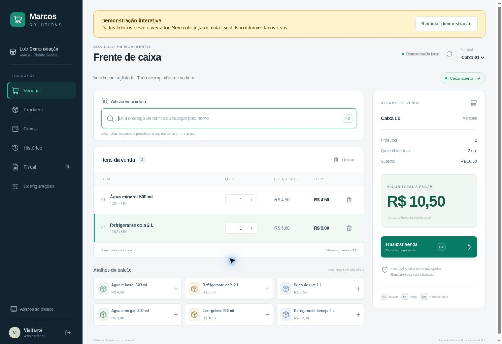
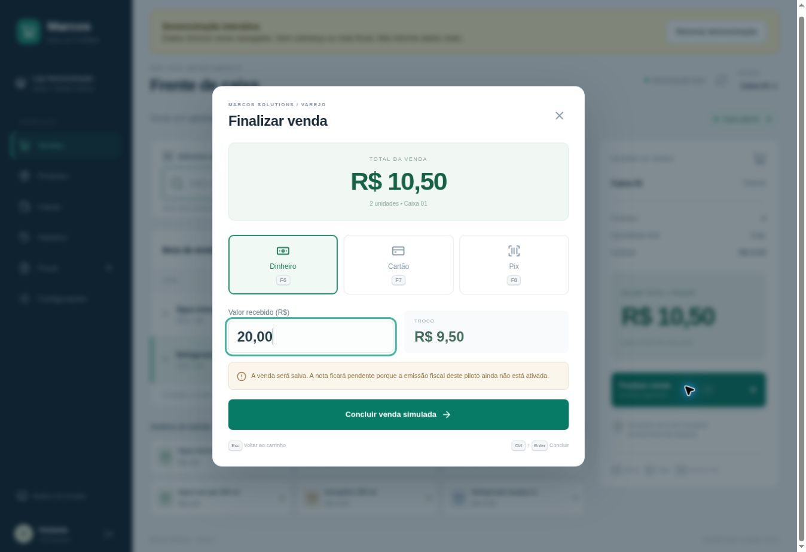
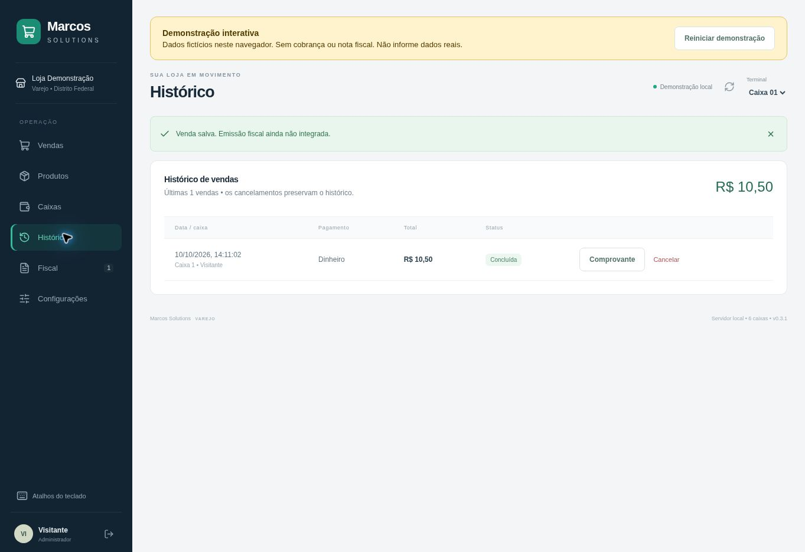

# Marcos Solutions Varejo — 0.3.2

## Demonstração online

[Abrir demonstração interativa](https://marcos-solutions-varejo-demo.vercel.app)

Acesso direto como Visitante, produtos fictícios e caixa inicial aberto. Simulações ficam somente no navegador, sem cobranças, emissão fiscal ou sincronização entre dispositivos. Não insira dados reais. O botão Reiniciar demonstração apaga as simulações locais.

Para gerar a versão estática: `npm ci`, `npm run build:demo` e `npm run test:demo`. Publique o conteúdo de `dist/`. O comando padrão `npm run build` continua gerando a versão conectada ao servidor local.

PDV integrado de teste para DF, até seis caixas em uma rede local. Frontend React + TypeScript, servidor Node.js e banco SQLite. O código é entregue integralmente, mas esta versão NÃO é um emissor fiscal de produção.

## Veja o PDV em ação

**[Assistir à apresentação de 24 segundos (MP4)](https://github.com/Santoszoi/marcos-solutions-varejo/raw/refs/heads/main/docs/media/pdv-demo.mp4)** · [Testar agora](https://marcos-solutions-varejo-demo.vercel.app/)

Vídeo sem áudio, montado com capturas reais da demonstração: carrinho → pagamento e troco → comprovante demonstrativo → histórico. Todos os dados são fictícios.

Ver pagamento e histórico

## Executar no Windows

1. Extraia a pasta inteira do ZIP Windows. Não execute dentro do ZIP nem copie apenas o EXE.
2. Abra `Marcos Solutions Varejo.exe`.
3. Crie a senha do administrador `Marcos` (mínimo oito caracteres).
4. Cadastre produtos ou carregue o catálogo de teste; abra o caixa antes da venda.
5. Leia o código de barras, informe o pagamento e conclua. A venda baixa estoque e gera comprovante NÃO FISCAL.

Não requer instalar Node.js na versão portátil. Binário Windows x64; não foi executado em Windows nesta validação. O programa não possui assinatura digital própria. Não desative o antivírus para executá-lo; se houver bloqueio, interrompa e investigue.

## Seis caixas na rede

A versão 0.3.2 exige HTTPS para acesso pela rede. Configure certificado confiável e chave privada no servidor usando `PDV_TLS_CERT` e `PDV_TLS_KEY`, conforme `SEGURANCA.md`, antes de executar `Iniciar-na-rede.cmd`. Os outros caixas acessam `https://IP-DO-SERVIDOR:4780`. O certificado precisa cobrir esse IP e 127.0.0.1 para a janela local do Electron, e ser confiável nos seis computadores. Não ignore erros de certificado. Sem configuração TLS, abra o EXE normalmente para uso somente no servidor por HTTP de loopback.

Libere a porta somente na rede privada da loja. Não publique o piloto na internet. O servidor ainda não é um serviço automático do Windows.

A perda da INTERNET não interrompe vendas enquanto servidor e rede local funcionarem. A perda da rede local ou do servidor impede finalizar vendas. O navegador preserva somente o rascunho do carrinho. Não existe sincronização com nuvem nem emissão em contingência fiscal implementada.

Cada operador abre seu caixa; administrador pode operar os demais. Fechar a janela principal encerra o servidor para todos. Não abra uma cópia independente do EXE em cada caixa esperando estoque compartilhado: os demais usam o navegador conectado ao servidor.

## Recursos entregues

- Busca por nome/código, carrinho, quantidades inteiras, total em centavos, verificação de estoque e preço no servidor.
- Dinheiro e troco; registro manual de cartão crédito/débito e Pix com confirmação pelo operador.
- Cadastro, custo, preço, margem sobre venda, entradas e movimentações de estoque.
- Seis caixas, abertura, sangria/suprimento, fechamento com diferença.
- Histórico recente, cancelamento administrativo no caixa ainda aberto, reposição de estoque e impressão pelo navegador.
- Usuários, senhas com hash, sessões, permissões, backup consistente e transações.
- Venda idempotente: repetir a mesma requisição não duplica a baixa de estoque.
- Catálogo fiscal declarativo, versionamento de configurações e auditoria; códigos tributários não estão fixos no motor principal.

## Fiscal e pagamentos: limites reais

O botão solicitado “Concluir Venda e Emitir Nota Fiscal” salva a venda, mas mostra antes da confirmação que a emissão está desativada. Todas as notas permanecem PENDENTES. Não há XML autorizado, assinatura A1, transmissão SEFAZ, DANFE/NFC-e, consulta de autorização, contingência fiscal, cancelamento fiscal ou cálculo tributário completo.

O último regime informado foi Lucro Real; esta atualização não configura automaticamente o catálogo tributário. Não preencha códigos por tentativa: o catálogo e os perfis precisam ser definidos e revisados para as operações da empresa. O módulo atual apenas seleciona e valida campos declarativos; não substitui motor fiscal ou validação de leiaute.

Cartão e Pix não são cobrados automaticamente. Confirme na maquininha/banco; não há TEF, adquirente, QR Pix dinâmico ou webhook. Cancelar uma venda no programa não estorna o pagamento no banco.

Este piloto utiliza SQLite local para dispensar instalação de um banco externo. A arquitetura PostgreSQL/nuvem discutida anteriormente NÃO foi implementada nesta entrega. Antes de produção: integração fiscal homologada, revisão tributária vigente, migração/escala conforme necessidade, endurecimento de segurança, teste de carga, restauração e dispositivos reais.

## Atalhos

| Tecla | Ação |
|---|---|
| F2 | Busca de produto |
| Setas + Enter | Selecionar e adicionar resultado |
| F4 | Finalizar venda |
| F6 / F7 / F8 | Dinheiro / cartão / Pix, dentro do pagamento |
| Ctrl + Enter | Concluir, sujeito às validações do servidor |
| + / - | Quantidade do item selecionado fora de campos de texto |
| Delete | Remover item selecionado |
| Esc | Fechar janela ou limpar busca |
| Tab / Shift + Tab | Navegar; foco contido no modal |

## Dados e backup

Na versão Windows: `%APPDATA%\Marcos Solutions Varejo\pdv.sqlite`. O programa cria cópia ao iniciar e a cada hora, mantendo as últimas 14. Use Configurações → Baixar backup e guarde em outro dispositivo. Backups contêm dados comerciais e hashes de usuários.

Restauração manual: encerre o servidor e todos os caixas, preserve uma cópia da pasta inteira de dados, mova o banco antigo e seus arquivos `-wal`/`-shm` para essa cópia, coloque o backup como `pdv.sqlite` e reabra. A restauração não tem assistente nesta versão. Não misture o backup com os arquivos WAL antigos.

## Código-fonte

- `src/App.tsx`: frente de caixa, pagamentos e retaguarda.
- `src/Modal.tsx`: modal com controle de foco e teclado.
- `src/model.ts`: tipos e valores monetários.
- `src/style.css`: interface responsiva e impressão.
- `server/store.mjs`: schema SQLite, transações e regras comerciais.
- `server/fiscal.mjs`: seleção fiscal pelo catálogo configurado.
- `server/http.mjs`: API, sessão, arquivos estáticos e backups.
- `desktop/main.cjs`: aplicativo Windows/Electron.
- `tests/`: testes do banco, API, fiscal declarativo e interface.

Com Node.js 24 e npm: `npm install`, `npm run build`, `npm test`, `npm start`. Acesse `http://127.0.0.1:4780`. `npm run desktop` abre Electron. O banco do modo Node fica em `dados/`; variáveis opcionais: `PDV_DATA_DIR`, `PDV_PORT`, `PDV_BIND`.

O diretório `dist/` já contém a interface compilada e permite `npm start` sem instalar dependências externas no servidor Node 24. Para alterar/recompilar o frontend é necessário instalar as dependências.

## Verificação

Build TypeScript/Vite e 19 testes automatizados aprovados. Incluem quatro formas de pagamento, teclado em DOM, autenticação, permissões, estoque concorrente via HTTP, persistência, backup e idempotência. A automação de navegador não pôde iniciar no ambiente; o teste da interface usa jsdom, não uma validação visual. Windows, impressora e leitor físico não foram testados. Veja `docs/VALIDACAO.md`.

## Atualização 0.3.1

Antes de substituir a aplicação: baixe um backup, resolva qualquer confirmação de venda pendente e esvazie/finalize os carrinhos em todos os terminais. Encerre o programa servidor, extraia a nova pasta inteira e execute. O banco existente recebe uma migração sem apagar vendas, usuários ou estoque. Carrinhos antigos sem preço registrado não são migrados: finalize-os antes da atualização. Não execute as duas versões simultaneamente.

Correções incluídas:

- Saldo de caixa calculado no servidor sobre todas as vendas, mesmo quando o histórico visível chega ao limite de mil registros.
- Preço unitário fixado no carrinho. Alterações do cadastro exigem conferência explícita pelo operador.
- Identificadores de venda compatíveis com acesso via IP da rede local.
- Confirmação interrompida preservada no navegador. Use “Consultar confirmação” após reconectar. Se a venda já existe, apenas o comprovante é recuperado; caso ainda não exista, o programa pergunta antes de reenviar o mesmo pedido. Não apague os dados do navegador enquanto houver pendência.
- Cópia da configuração fiscal na venda para rastrear a versão utilizada; vendas antigas continuam preservadas, sem configuração retroativa inventada.
- Backup com nomes exclusivos, inclusive quando duas solicitações acontecem no mesmo instante.

O timeout de conexão não significa que uma venda falhou. Não receba o pagamento novamente antes de consultar a confirmação. O rascunho e a confirmação pendente pertencem ao navegador usado naquela operação.

Continuam fora desta entrega: emissão real NF-e/NFC-e e sua contingência, sincronização com nuvem, integração automática Pix/TEF, homologação da impressora/leitor e teste do EXE no Windows. Esta atualização não torna o piloto um sistema fiscal pronto para produção.

## Atualização 0.3.2 — segurança

Leia `SEGURANCA.md` antes de atualizar. Há restrições adicionais por operador, sessões com expiração por inatividade, validação de origem e exigência de TLS para a rede. O uso local continua disponível.
